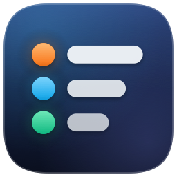
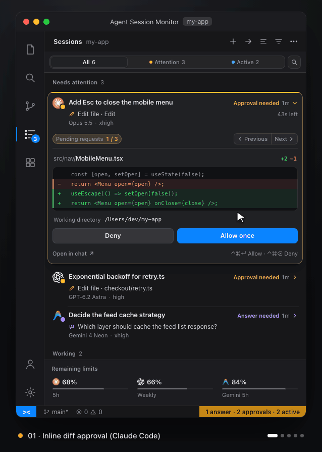

<div align="center">



# Agent Session Monitor

**Monitor and control Claude Code, Codex, and Antigravity sessions from one VS Code sidebar.**


**English** · [한국어](README.ko.md)

[Features](#features) · [Support](#support) · [Quick start](#quick-start) · [Language](#language) · [Shortcuts](#keyboard-shortcuts) · [Settings](#settings) · [Security](#privacy-and-security) · [Development](#development)

<br />



<sub>Inline diff approvals · parallel request queue · subagent tree · work story · subscription limit gauges</sub>

</div>

---

## Features

When you run several AI coding agents at once, you can see which session is waiting for approval and what each one is changing, and act on it, from one place instead of hopping between chat tabs.

<table>
  <tr>
    <td width="50%" valign="top">
      <strong>One board for every agent</strong><br />
      Sorts the current folder's <strong>Claude Code · Codex · Antigravity</strong> sessions into <code>Needs attention · Working · Earlier</code>. Segment filters, instant <code>/</code> search, per-agent filters, and <code>+</code> to start a new session.
    </td>
    <td width="50%" valign="top">
      <strong>Inline approvals &amp; a parallel queue</strong><br />
      Allow, deny, or answer file edits (color diff · <code>+N −M</code>), commands, and choice questions (several questions, multiple selection) from the main Claude Code session in VS Code, right in the panel. Step through several waiting requests with the <code>1 / N</code> stepper.
    </td>
  </tr>
  <tr>
    <td width="50%" valign="top">
      <strong>Work story &amp; subagent tree</strong><br />
      Press <code>⋯</code> or <code>I</code> to see the original request, the live plan checklist and progress, one-click changed-file chips, and the step timeline. Subagents are grouped under an <code>active/total</code> badge, and finished ones clear in one go.
    </td>
    <td width="50%" valign="top">
      <strong>Native macOS notifications &amp; window routing</strong><br />
      When the VS Code window is inactive, a bundled Universal Binary helper (Apple Silicon · Intel) shows a notification with the agent's logo. Clicking it takes you to the exact VS Code window and session where that project is open.
    </td>
  </tr>
  <tr>
    <td width="50%" valign="top">
      <strong>Subscription limit gauges</strong><br />
      Shows each tool's remaining limits and reset countdown in the footer tiles and detail cards, using only the signed-in official CLIs' local usage lookups (no chat turn is spent).
    </td>
    <td width="50%" valign="top">
      <strong>Zero runtime dependencies &amp; safe defaults</strong><br />
      Runs light with <strong>0</strong> external npm runtime packages. In Restricted Mode, the session list is still shown, safely and read-only.
    </td>
  </tr>
</table>

---

## Support

| Feature | Claude Code | Codex | Antigravity |
|---|:---:|:---:|:---:|
| Live session status · work story · subagents | ✅ | ✅ | ✅ |
| Structured preview of waiting requests (diff · questions · permissions) | ✅ | ✅ | ✅ |
| Inline approvals / answers in the panel | ✅ *(main VS Code session)* | Read-only · jump to chat | Read-only · jump to chat |
| Subscription limits · reset countdown | ✅ | ✅ | ✅ |

> [!NOTE]
> The Codex and Antigravity hook protocols don't let an outside panel inject a response, so they get a read-only preview and a one-click jump to the chat. Claude Code plan approvals (`ExitPlanMode`), subagents, oversized requests, CLI sessions, and requests whose wait time ran out also hand off to the chat.

- **macOS**: everything (automatic hook setup, Universal Binary native notifications, the built-in `sqlite3`)
- **Linux**: automatic hook setup, inline approvals, and VS Code in-app notifications *(reading Codex and Antigravity metadata needs the `sqlite3` CLI)*
- **Windows**: not supported (built on Unix domain sockets and POSIX hooks)

---

## Quick start

**Requirements**: VS Code `^1.120.0` · Node.js `>= 18` *(`>= 20` to run the tests)* · Python 3 *(VSIX packaging)*

### 1. Build and install

```bash
git clone https://github.com/dh3668/agent-session-monitor.git
cd agent-session-monitor

# Build the VSIX package (no external npm dependencies)
npm run package

# Install it in VS Code
code --install-extension agent-session-monitor-1.0.1.vsix --force
```

### 2. Connect the agent hooks

1. Open the **Agent Session Monitor** icon in the VS Code Activity Bar.
2. Use **Connect** in the panel (or `⇧⌘P` → **`Agent Session Monitor: Connect Agents`**) and pick the tools to connect.
3. *(Codex)* Run **`/hooks`** in the Codex CLI and **trust** the registered hooks to get approval requests and tool activity too. *(Before you trust them, sessions in progress still appear wherever local run records and locks can be read.)*
4. *(macOS)* Run **`Agent Session Monitor: Test Notification`** and allow notifications, so you get clickable alerts even when you're outside the window.

> [!IMPORTANT]
> **Uninstalling the VS Code extension does not remove the hooks it added to each tool's settings.** Run **`Agent Session Monitor: Disconnect Agents`** before you uninstall to clean them up.

<details>
<summary>Which files the hooks change, and updates</summary>

- `Connect Agents` adds this extension's hook entries only to the selected tools' user settings (`~/.claude/settings.json`, `~/.codex/hooks.json`, `~/.gemini/config/hooks.json`) and keeps your existing hooks.
- When an extension update changes the hook setup, a **hooks need an update** banner appears at the top of the panel. Refresh them with **Update** (or `Connect Agents`). *(Codex may need you to trust the hooks again with `/hooks`.)*
- If you already uninstalled the extension, remove the `agent-session-monitor` hook entries from those settings files by hand.

</details>

---

## Language

Agent Session Monitor follows VS Code's display language: Korean when VS Code is set to Korean, English otherwise. That covers the panel, notifications, commands, and settings.

- **Switch**: `⇧⌘P` → **Configure Display Language** → choose `en` or `ko` → restart VS Code. *(Korean needs the Korean Language Pack for VS Code.)*
- The name macOS shows for the notifier in Notification Center and System Settings follows the macOS system language.

---

## Keyboard shortcuts

<details>
<summary><strong>All shortcuts (10)</strong></summary>

<br />

| Action | macOS | Linux |
|---|---|---|
| Allow the open request / send the answer *(works while the editor has focus)* | `⌃⌘↵` | `Ctrl+Alt+Enter` |
| Deny the open request *(works while the editor has focus)* | `⌃⌘⌫` | `Ctrl+Alt+Backspace` |
| Next session to check | `⌃⌘N` | `Ctrl+Alt+N` |
| Back to the previous chat | `⌃⌘B` | `Ctrl+Alt+B` |
| Switch session in the current folder (QuickPick) | `⌃⌘L` | `Ctrl+Alt+L` |
| Focus the Agent Session Monitor panel | `⌃⌘A` | `Ctrl+Alt+A` |
| Search in the panel | `/` | `/` |
| Open / close the work story *(also works with a Korean input method)* | `I` | `I` |
| Close search · work story · the open request card | `Esc` | `Esc` |
| Choose an option / move between rows / expand subtasks | `1`–`9` · `↑/↓` · `←/→` | `1`–`9` · `↑/↓` · `←/→` |

</details>

## Settings

<details>
<summary><strong>All extension settings (9)</strong></summary>

<br />

| Setting | Default | Description |
|---|---|---|
| `agentSessionMonitor.notifications` | `attentionAndDone` | Which events notify you (`attentionAndDone` · `attention` · `off`) |
| `agentSessionMonitor.awayNotifications` | `true` | Send native macOS notifications while VS Code is inactive |
| `agentSessionMonitor.notificationSound` | `true` | Play a sound with native macOS notifications |
| `agentSessionMonitor.inlineActions` | `true` | Handle Claude Code approvals and questions right in the panel |
| `agentSessionMonitor.inlineActionSeconds` | `45` | How long a request can be handled in the panel (15–540 s; after that it moves to the chat) |
| `agentSessionMonitor.activityDetail` | `true` | Show requests, plans, steps, changed files, and reply summaries *(memory only)* |
| `agentSessionMonitor.subscriptionUsage` | `true` | Check subscription limits locally through the official CLIs (5-minute cache) |
| `agentSessionMonitor.chatLocation` | `secondarySidebar` | Where sessions open (`secondarySidebar` · `lastUsed`) |
| `agentSessionMonitor.otherFolders` | `true` | Show chips for requests waiting in other folders |

</details>

---

## Privacy and security

- **Activity stays in memory**: prompts, tool inputs, diffs, and reply summaries live only in the extension host's memory for trusted workspaces and are never written to disk snapshots. *(If both `awayNotifications` and `activityDetail` are on, a short summary goes into the macOS notification body for an inactive window, where Notification Center may show and keep it. It is cleared when you return to the window.)*
- **Authenticated local bridge**: traffic between the hooks and the extension host over a Unix domain socket is signed with Ed25519 and checked against the workspace's physical path.
- **Misclick and spoofing guards**: input is held briefly right after a request appears (~0.5 s), rows stay put while the pointer is moving, BiDi and invisible characters (such as `‮`) are shown as explicit escapes, long runs of blank lines are folded, and you're warned about content you haven't scrolled through.
- **File access boundary**: opening a changed file works only for files the session recorded that actually exist inside the current workspace folder, symbolic links included.
- **Restricted Mode**: in untrusted folders, only the session list is shown, read-only; hook collection, inline approvals, and subscription checks are turned off.

---

## Development

Builds and checks use only Node.js's built-in test runner and the Python standard library, with no runtime dependencies.

```bash
npm test                  # All unit, integration, and strict-CSP browser tests
npm run package           # Build the VSIX and verify its require graph
sh scripts/smoke-host.sh  # Smoke test in a real VS Code extension host
npm run showcase          # Standalone browser demos: design/showcase.en.html (English) and design/showcase.html (Korean)
npm run build:notifier    # Rebuild the macOS Universal Binary notifier helper (needs swiftc)
```

**Translations**: UI text is written in English in the code. Korean lives in `media/i18n.js` (panel and extension host) and `package.nls.ko.json` (commands and settings). `npm test` fails if any text shown in the UI has no Korean entry.

<details>
<summary>Directory structure</summary>

```text
agent-session-monitor/
├── src/                    # Extension host, hooks and the Ed25519 local bridge, metadata, subagents, subscription limits, notifications
├── media/                  # Strict-CSP webview modules (i18n.js, format.js, panel-*.js, panel.css) and bundled icons
├── native/macos-notifier/  # macOS UNUserNotificationCenter Universal Binary source, app name translations, build script
├── scripts/                # Dependency-free VSIX packager, extension host smoke test, showcase builder
├── tests/                  # Unit, integration, strict-CSP browser, translation, and host smoke tests
├── assets/                 # README sidebar demo GIFs (demo.gif English · demo.ko.gif Korean)
└── package.nls*.json       # Command and setting text (English · Korean)
```

</details>

---

## Trademarks and license

Agent Session Monitor is an independent open-source project and is not affiliated with, sponsored by, or endorsed by Anthropic, OpenAI, or Google. Claude and Claude Code are trademarks of Anthropic, PBC; OpenAI, ChatGPT, and Codex are trademarks of OpenAI; Google, Antigravity, and Gemini are trademarks of Google LLC.

This repository and the VSIX package do not include or redistribute any official third-party logo files. When the official VS Code extensions (`anthropic.claude-code`, `openai.chatgpt`, `google.google-antigravity`) are installed locally, their local icons are referenced at runtime; otherwise the project's own monogram fallback badges (`CL`, `CX`, `AG`) are used.

Distributed under the [MIT License](LICENSE).
